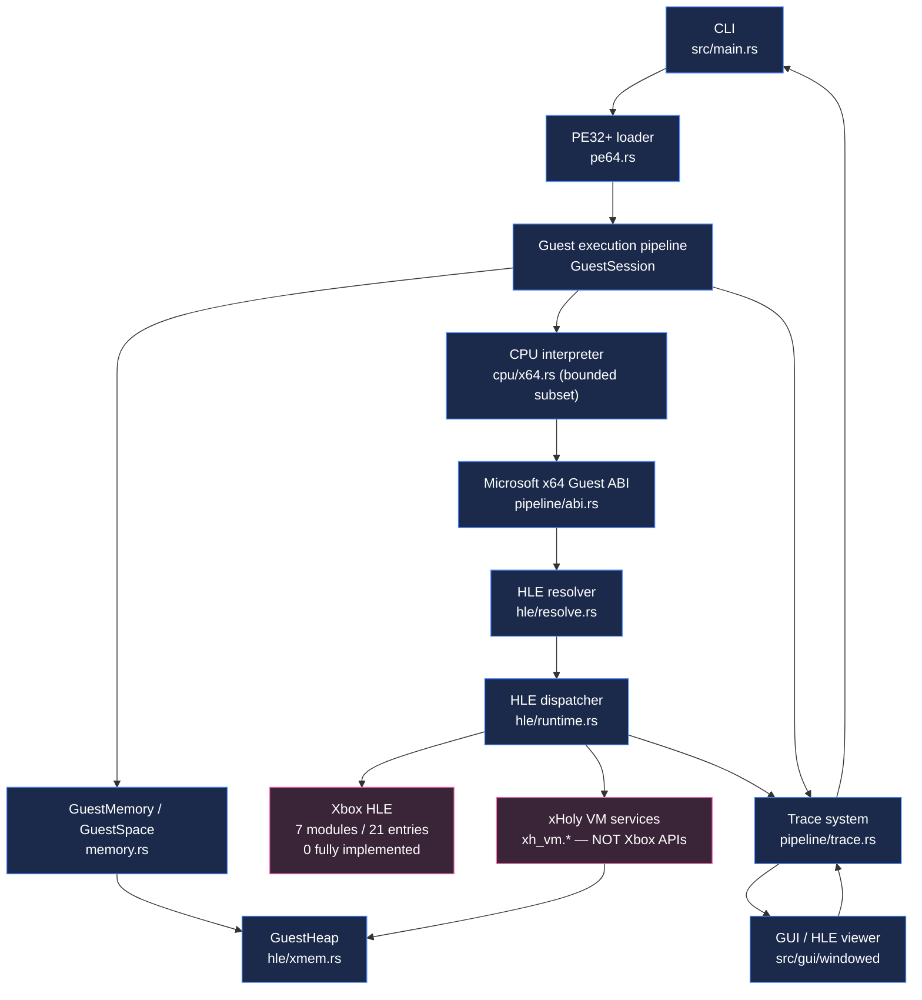

<p align="center">
  
</p>

<p align="center"><b>Redeem Your Games</b></p>

# xHoly — Independent Xbox HLE Emulator (Research)

xHoly is an independent, open-source **high-level emulation (HLE) research
project** for Xbox One and Xbox Series X|S software, written primarily in
Rust. It runs self-authored PE32+ guest programs through its own bounded
x86-64 pipeline and reimplements console software interfaces on the host.

> **Honest status:** xHoly executes synthetic PE32+ guests end-to-end
> (loader → memory → CPU → HLE → trace). **No retail Xbox title has been
> confirmed to boot or run.** The Xbox HLE registry contains **21 entries,
> none fully implemented**; only two XMem functions are partially
> implemented. xHoly VM services are real but are **not Xbox APIs**.

---

## Table of contents

1. [Project goals](#1-project-goals)
2. [Current development status](#2-current-development-status)
3. [Supported host platforms](#3-supported-host-platforms)
4. [Xbox One and Xbox Series X|S](#4-xbox-one-and-xbox-series-xs)
5. [Architecture overview](#5-architecture-overview)
6. [HLE architecture](#6-hle-architecture)
7. [Xbox HLE compatibility](#7-xbox-hle-compatibility)
8. [xHoly VM services and their boundary](#8-xholy-vm-services-and-their-boundary)
9. [CPU emulation](#9-cpu-emulation)
10. [Guest memory](#10-guest-memory)
11. [PE32+ loader](#11-pe32-loader)
12. [Guest execution pipeline](#12-guest-execution-pipeline)
13. [GPU architecture and status](#13-gpu-architecture-and-status)
14. [Trace and diagnostics](#14-trace-and-diagnostics)
15. [CLI](#15-cli)
16. [GUI](#16-gui)
17. [Building from source](#17-building-from-source)
18. [Installation and usage](#18-installation-and-usage)
19. [Tests](#19-tests)
20. [Project structure](#20-project-structure)
21. [Roadmap](#21-roadmap)
22. [Known limitations](#22-known-limitations)
23. [Legal and technical separation](#23-legal-and-technical-separation)
24. [Contributing and development](#24-contributing-and-development)
25. [License and acknowledgements](#25-license-and-acknowledgements)

---

## 1. Project goals

The project direction is defined in [ROADMAP.md](ROADMAP.md) and the binding
architecture decision
[docs/adr/0001-target-architecture.md](docs/adr/0001-target-architecture.md):

- target **Xbox Series X|S (Gen9)** software; Xbox One is a historical
  target description, with no retail compatibility claimed;
- use **HLE** for console interfaces instead of cycle-accurate hardware
  simulation;
- keep a **modular, independently testable** Rust crate with honest
  diagnostics and derived progress;
- keep guest/host address spaces strictly separate and never expose host
  pointers to guest code;
- remain independent: **no Microsoft GDK/GDKX dependency**, no copied
  ScarlettX implementation, no proprietary SDK content.

The complete Xbox API evidence audit lives in
[`docs/xbox-hle-inventory.md`](docs/xbox-hle-inventory.md).

## 2. Current development status

| Area | Reality |
|---|---|
| PE32+ loading | Parse, validate, map, relocate and resolve imports for synthetic fixtures |
| Guest CPU | Small, explicitly bounded x86-64 interpreter subset |
| Guest execution | Full chain: loader → memory → stack → CPU → HLE → guest result → trace |
| Xbox HLE | 7 modules / 21 entries: **0 Implemented**, 2 PartiallyImplemented, 2 Unsupported, 17 Unknown |
| xHoly VM services | 4 modules / 17 functions, fully implemented, explicitly **not Xbox APIs** |
| Trace | Schema v2 JSON, v1 import compatible; CLI and GUI share the same data |
| Retail compatibility | **None confirmed** — no retail title boot |

Progress percentages are roadmap-derived, not compatibility numbers.

## 3. Supported host platforms

| Platform | State |
|---|---|
| Windows x86-64 | Primary development target; CLI, tests and windowed GUI verified on the development host |
| Linux x86-64 | Supported build target in CI; not verified locally on the development machine |
| ARM64 hosts, macOS | Not supported; outside the target scope |

Guest code is x86-64. Legacy Xbox 360 / PowerPC / AArch64 demo code remains
behind feature flags or as test harnesses and is **not** a Series X|S path.

## 4. Xbox One and Xbox Series X|S

ADR 0001 declares **Xbox Series X|S (Gen9 / Scarlett)** the only current
target. Xbox One appears in the project description as the broader console
family, but there is no verified Xbox One package path, no kernel ABI and no
retail compatibility claim. The PE32+ format is used for synthetic guests;
ordinary Windows PE32+ files are **not** complete Xbox executable packages.
Retail containers, encryption and access control are out of scope.

## 5. Architecture overview



The visual separation between Xbox HLE (compatibility claims) and xHoly VM
services (scaffold) is deliberate and enforced in code, tests and docs.

## 6. HLE architecture

- **Registry** (`src/core/hle/mod.rs`): metadata only. States are
  `Implemented`, `PartiallyImplemented`, `Unsupported`, `Unknown`. No
  function signature, ordinal, convention or return value is invented.
- **Resolver** (`src/core/hle/resolve.rs`): one pure verdict rule shared by
  the import analyzer, the guest import binder and the dispatcher. Explicit
  function entries always win; only explicitly unsupported modules fall
  back; partial modules never inherit credit.
- **Dispatcher/Runtime** (`src/core/hle/runtime.rs`): the only call path.
  Registered implementations may complete or fail; `Unsupported`/`Unknown`
  results never carry a value. Bounded failure log (64) and dispatch trace
  (128), typed `DispatchFailure`, `call_count()` and `reset_diagnostics()`.
- **Execution context** (`HleContext`): guest heap plus deterministic xHoly
  VM kernel/system state. No global mutable state.

## 7. Xbox HLE compatibility

| Module | State | Notes |
|---|---|---|
| `xam.xex` | Unknown | Only Xbox 360 Xenia ordinals; excluded by ADR 0001 |
| `xgameruntime.dll` | Unsupported | No implementation; no public signature in repo |
| `d3d12_xs.dll` | Unsupported | No guest device shim or draw translation |
| `xmem.dll` | PartiallyImplemented | `XMemAlloc`/`XMemFree` only; attributes not decoded |
| `xg_xs.dll` | Unsupported | Exact imports differ from MIT samples |
| `gameinput.dll` | Unsupported | Ordinal claim only; no signature/vtable |
| `msvcp140.dll` | Unsupported | Host CRT, not an Xbox API |

Function tally: **0 Implemented, 2 PartiallyImplemented, 2 Unsupported,
17 Unknown**. Full per-API evidence and the "cannot implement without
inventing semantics" list are in
[`docs/xbox-hle-inventory.md`](docs/xbox-hle-inventory.md). No compatibility
percentage is derived from this table.

## 8. xHoly VM services and their boundary

`hle::with_xh_vm_entries()` defines four clearly named modules:
`xh_vm.mem.dll`, `xh_vm.sys.dll`, `xh_vm.krn.dll`, `xh_vm.sync.dll` with 17
fully implemented services (memory query/protect/stats, ticks/info, guest
thread and event/mutex state machines). Their evidence strings explicitly
say **"NOT an Xbox API"**.

They are deterministic host scaffolding with xHoly-owned semantics (VM
ticks, opaque integer handles, documented wait results) and **never** enter
the Xbox compatibility inventory or its percentages. The read-only analyzer
and CLI use the Xbox-only registry; `HleRuntime::with_xh_vm()` is used only
by synthetic guests.

## 9. CPU emulation

`src/core/cpu/x64.rs` is a small, explicit interpreter — not a complete
x86-64 emulator. Supported: MOV (`B8+r`, `89`, `8B`, `C7 /0`), ALU
(`ADD/OR/AND/SUB/XOR/CMP` via `83/81 /n` and `01/09/21/29/31/39`,
`03/0B/23/2B/33/3B`), TEST, LEA, INC/DEC (`FF /0,/1`), MOVZX/MOVSX, SETcc,
JMP/Jcc, CALL/RET, PUSH/POP, NOP/HLT. Address modes: register,
`[reg+disp]`, SIB and RIP-relative. Flags modelled: CF/ZF/SF/OF; PF/AF are
not, so JP/JNP fault explicitly. Byte/word ALU, shifts, IMUL and CMOV are
not implemented. Other CPU layers (AArch64 test interpreter, Phase-1
scaffold, x86-64→WASM JIT research) are separate and unrelated.

## 10. Guest memory

`GuestMemory` (`read_bytes`/`write_bytes`/`read_u64`/`write_u64`) is the
single access abstraction. `Memory` is a flat 1 GiB window at
`regions::TITLE`; `GuestHeap` is the xmem guest heap above it; `GuestSpace`
routes by guest address range and rejects cross-boundary accesses.
`XMEM_HEAP_BASE`, `DEFAULT_ALIGNMENT = 16` and the 1 GiB resident cap are
**xHoly policy**, not verified Xbox values. Allocations track size,
alignment, raw attributes and protection; freed space is not reused. There
is **no MMU**, no paging and no hardware fault handling.

## 11. PE32+ loader

`pe64.rs` parses PE32+ headers and sections, validates structural bounds,
maps sections, applies DIR64/HIGHLOW relocations and resolves import
descriptors and IAT slots. It rejects non-PE data, wrong machine types,
overlapping sections, out-of-image sections, non-executable entry points and
unsupported relocation types with structured `Pe64Error`s. Synthetic
fixtures are generated in source (`synthetic_pe`, `synthetic_pe_calling`,
`synthetic_boot_guest`, `synthetic_compute_guest`, `synthetic_multi_hle_guest`).
Delay-load imports, TLS callbacks, encrypted retail packages and Xbox
executable containers are **not** supported.

## 12. Guest execution pipeline

`GuestSession::load` validates and maps the image, resolves imports against
the chosen registry, installs the guest stack with an entry return sentinel
and registers IAT slots as HLE transition points. `run(max_steps)` steps the
bounded CPU, reads Microsoft x64 arguments (`RCX/RDX/R8/R9`, stack args via
the 32-byte shadow space), dispatches through the single runtime, writes
results to `RAX`, and records a structured `ExecutionReport`. Unsupported,
unknown and failed calls stop execution with `RAX` untouched. An optional
MNEMONIC field in step records is additive and M34-compatible.

## 13. GPU architecture and status

Host presentation uses wgpu (Vulkan/OpenGL/software selection) and the
windowed GUI blits a synthetic guest framebuffer. `src/core/hle/graphics.rs`
provides a vendor-neutral *seam* (`HostBackendKind`, `HostRenderBackend`,
`GraphicsRuntime`) with device **bookkeeping only**: `submit_draw` and
`create_resource` always return `GraphicsError::Unsupported`. This is
**not an Xbox GPU emulator**: no guest D3D12 device, no draw-call
translation, no resource or shader compatibility. Creating a host GPU
context does not implement `D3D12CreateDevice`.

## 14. Trace and diagnostics

`ExecutionReport` and its events serialize and deserialize. `.xholy-trace.json`
(schema v2, v1 import compatible, 64 MiB cap) stores the report, optional
boot phases and instruction records. Import validates format, version,
consecutive step numbers, boot/report consistency and rejects malformed or
unsupported input. Derived `hle_call_stats` shows call outcomes in CLI text
and the GUI `HLE CALLS` panel without any schema change. The GUI trace
viewer offers timeline, registers, imports, HLE calls, faults and boot
phases, plus Open/Save/Refresh/Clear controls (path via `--gui-trace`; no
native dialog dependency).

## 15. CLI

| Command | Effect |
|---|---|
| `xholy --progress` | Roadmap report derived from `progress.json` |
| `xholy --analyze PATH [--json]` | Read-only PE32+ import analysis |
| `xholy --trace PATH [--trace-out FILE] [--json]` | Execute a PE32+ file in the bounded pipeline and export its trace |
| `xholy --guest-test [--json] [--max-steps N]` | Run the built-in synthetic guest boot and print its trace |
| `xholy --gui` / `--gui-tui` / `--gui-headless` | Windowed GUI, terminal UI, or offscreen rendering |
| `xholy --gui-trace PATH` | Load an exported trace into the GUI viewer |
| `xholy --game PATH [--max-steps N]` | Run a bundled guest image through the legacy execution path |
| `xholy [IMAGE] --mount PATH --list --drives` | Library and optical-source commands |

All commands work headless; no graphical environment is required for CLI
or test execution.

## 16. GUI

The winit/wgpu windowed GUI is a launcher-style interface with a game grid,
view tabs, console, settings, emulation overlay and the HLE Trace Viewer.
It is host-only: it presents frames and diagnostics but does not translate
guest GPU commands. The terminal UI shares the configuration but not the
trace viewer. GUI tests exercise state and rendering without a real window.

## 17. Building from source

```powershell
git clone https://github.com/baummarder/xHoly.git
cd xHoly
cargo build --release
cargo test --workspace
```

Optional Scala modules live in `scala/` (requires `sbt assembly`); they are
not required for the Rust emulator. The native window-manager demo is
Windows-only (`cpp/window_manager/`).

## 18. Installation and usage

Prebuilt releases are published on the project's GitHub releases page when
available. For local use, build with `cargo build --release`, then run the
CLI commands above. See [`Install.md`](Install.md) for host prerequisites;
that file may contain user-local notes and is preserved as-is by automation.

## 19. Tests

```powershell
cargo fmt --all -- --check
cargo check --workspace
cargo test --workspace
cargo clippy --workspace --all-targets --all-features
```

Integration suites cover the guest pipeline (`tests/guest_pipeline_tests.rs`),
M33 boot (`guest_boot_tests.rs`), M34 GUI trace (`gui_trace_tests.rs`),
M35 execution expansion (`guest_expansion_tests.rs`), M36 HLE runtime
(`hle_expansion_tests.rs`) and the M37 Xbox inventory
(`xbox_hle_inventory_tests.rs`). Fixtures are generated in source; no
commercial game binary is used.

## 20. Project structure

| Path | Content |
|---|---|
| `src/core/cpu/` | Bounded x86-64 interpreter, AArch64 test interpreter, scaffold, translator |
| `src/core/loader/` | PE32+, XEX2, ISO and image parsing |
| `src/core/pipeline/` | GuestSession, ABI, diagnostics, imports, boot, trace |
| `src/core/hle/` | Registry, resolver, runtime, xmem, kernel, system, graphics |
| `src/core/kernel/` | Legacy syscall/scheduler models (not a Gen9 Xbox ABI) |
| `src/gui/`, `src/game` frontends | winit/wgpu GUI, terminal UI, renderers |
| `src/jit/` | x86-64→WASM research (not the guest CPU path) |
| `tests/` | Integration suites listed above |
| `docs/` | Whitepaper, ADR, milestone reports, Xbox HLE inventory |

## 21. Roadmap

See [ROADMAP.md](ROADMAP.md), [STATUS.md](STATUS.md) and [MISSING.md](MISSING.md).
Milestone reports: [M33](docs/milestone-33.md), [M34](docs/milestone-34.md),
[M35](docs/milestone-35.md), [M36](docs/milestone-36.md),
[M37 inventory](docs/xbox-hle-inventory.md). Next research gates require
**citable public Xbox signatures** before any new Xbox API can be implemented.

### Project development progress

The figures below are generated from and validated against
[`progress.json`](progress.json) by `src/progress.rs` (a unit test fails
if this README section goes stale). Run `xholy --progress` for the same
report on the command line.

**Overall roadmap completion: 60.2%**

`[▓▓▓▓▓▓▓▓▓▓▓▓░░░░░░░░] 60.2%`

| Category | Weight | Completion |
|---|---:|---:|
| CPU & Execution | 20% | 40.0% |
| HLE & System Runtime | 20% | 75.0% |
| GPU & Shader Translation | 20% | 50.0% |
| Memory & Storage | 10% | 82.5% |
| Audio & Input | 10% | 50.0% |
| Game Compatibility & Boot | 15% | 60.0% |
| GUI & Infrastructure | 5% | 100.0% |

Last verification: 2026-11-30.

Calculation: each task adds `weight x credit` to its category, where credit is 0 for Planned and Blocked, 0.5 for Partially Implemented, and 1 for Implemented and Verified. Task weights total 100 within each category, so the category sum is its completion percentage. Overall completion is the category completion weighted by the category weights. Everything is derived from `progress.json` by `src/progress.rs`. This measures roadmap progress only, not game compatibility, production readiness or retail boot success.

### Performance targets (goals, not measurements)

| Metric | Target |
|---|---|
| Frame rate | 60 FPS @ 1440p/4K |
| Input latency | < 15 ms |
| Compatibility | Xbox Series X\|S (Gen9): research goal; no retail title runs yet |

## 22. Known limitations

- **No retail Xbox title is confirmed to boot or run.**
- No complete x86-64 emulator; the bounded subset faults on unsupported opcodes.
- No Xbox kernel ABI, no MMU, no paging, no retail package support.
- No Xbox GPU emulation, no draw-call or shader translation.
- Xbox HLE: 0 fully implemented APIs; XMem attributes are not decoded.
- xHoly VM services are scaffold and must not be read as Xbox compatibility.
- Legacy Xbox 360 / PowerPC / AArch64 code is outside the Gen9 target.
- GUI and CLI diagnostics are research tools, not a consumer emulator UI.

## 23. Legal and technical separation

xHoly is independent of Microsoft and does not include or link Microsoft
GDK/GDKX SDKs. No proprietary code, retail game binary or copyrighted game
asset is part of this repository. The ScarlettX README is used only as a
compatibility reference (target names, DLL list); no source was copied and
its licence status is unresolved. Xbox 360 ordinals from Xenia are
feature-gated legacy material and are never used as Gen9 evidence. See
[ADR 0001](docs/adr/0001-target-architecture.md) and the legal notes below.

## 24. Contributing and development

Work in focused, testable modules. Every behavioural change needs unit or
integration tests; every API status change needs a citable public source
and documented semantics. Run all four Cargo checks before committing.
Do not add dependencies without a concrete reason. Do not invent API
signatures, ordinals, flag values or return codes.

## 25. License and acknowledgements

The Rust crate is licensed under Apache-2.0 (see `Cargo.toml`). Third-party
dependencies retain their own licences. Public technical documentation from
Microsoft, MIT-licensed `microsoft/DirectXTex` and Xbox-ATG samples, and
the community ScarlettX compatibility notes are acknowledged as references
only; no code was copied from them.

---

<p align="center"><b>xHoly remains an independent research project.</b></p>
